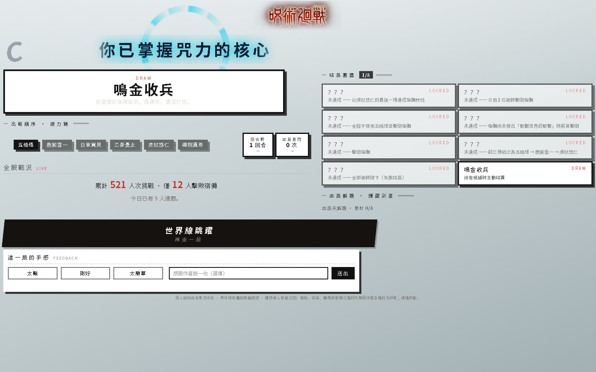

# 人外魔境 · 新宿决战

**五条悟 vs 宿傩。回合制，可以自己上手打。单个 HTML 文件 —— 打开就能打，断网也能打。**

[▶ 在线试玩](https://jjk-shinjuku-battle-83982.app.workbuddy.host/)　·　[⤓ 安卓安装包](https://jjk-shinjuku-battle-83982.app.workbuddy.host/download)　·　52.7 MB 单文件　·　零依赖

> 试玩走的是国内节点，同一份文件也发布在 [GitHub Pages](https://linziyang777.github.io/jjk/)，海外访问反而更顺；国内打开要等一会儿——52 MB 摆在那儿，绕不过去。
>
> 仓库里的 `index.html` 就是当前版本（v6.5），可以直接下载离线玩。

  

无下限展开的「无量空处」—— 墨色眼睛横贯画面，魔虚罗立在中间，宿傩在右

## 这是什么

《咒术回战》新宿决战的同人二创，做成能上手操作的对战。挑一名术师，轮流出招、格挡、攒咒力开领域，在金色计量条里赌一发黑闪。对面那位是宿傩。

六名可操作角色，招式、领域、语音各不相同；宿傩会换形态、召式神、读世界斩，也会在被打空血之后现出四臂二面的原身。

## 长什么样

  
  
  

选人 → 战斗 → 结算（结算页有接力链、结局图鉴、全服战况与手感反馈）

三张都是无头 Chrome 打开 `index.html` 直接抓的实机画面，没有后期合成。

## 参战角色

| 角色 | 术式 | 奥义 |
|---|---|---|
| 五条悟 | 术式顺转·苍 / 苍·拳（可切换双形态） | 虚式·茈 |
| 鹿紫云一 | 术式顺转·放电 | 幻兽琥珀·解放 |
| 日车宽见 | 法槌·开庭 | 处刑人之剑 |
| 虎杖悠仁 | 迳庭拳 | 赤血操术·穿血 / 领域 |
| 乙骨忧太 | 太刀·咒斩 | 领域·真赝相爱 |
| 真希 | 释魂刀 | 无声突袭 |

## 怎么玩

- 选角色 → 选难度 → 开打。出招、格挡、攒咒力，够了就开领域。点首页的「術式公開」可以翻完整的战斗规则（分角色技能 / 机制 / 数值）。
- **黑闪**：出招有 8% 概率触发（虎杖 14%），连续黑闪每次 +3%，最高 +15%。金色计量条点中时，该击伤害 ×2。
- **完美格挡**：宿傩出招前有黑色预警，按下防御的那一刻判定——时机准就「完璧」架开，下回合行动力 +1。
- **五条悟 1 技双形态**：苍（可挂引力标记，配合「赫」引爆）⇄ 苍·拳，技能框右上角角标随时切换；血量不满时立绘会换成蓝焰拳姿。
- **无下限·不可侵**：五条 2 技，三回合内一切攻击在身前停住；魔虚罗登场后「适应」两回合即破解。
- **术式熔断与反转术式**：领域对拼输了就熔断，除反转术式外全封；反转术式回 30% 生命、修好熔断，还能让「无量空处」多开一次（本局上限 2 次）。演出播完宿傩才会出手。
- **领域寿命**：只要魔虚罗还在场上，五条的无量空处与乙骨的真赝相爱都撑不过两回合——第 3 回合开始时裂纹会先一步爬满结界的边缘。想保住领域，得先解决魔虚罗。
- **乙骨的模仿术式**：里香在场时二技能变成「模仿术式」，池中五招随机抽取 —— 赤血操术·穿血（15~20%）／言灵术式／宿傩的「解」／宿傩的「捌」／邪去侮天梯（10~15%，领域里那次同样结算）。除言灵与天梯，每招冷却 1 回合、冷却好自动轮换下一招；言灵能定住宿傩一回合并给自己多一次行动，天梯则永久抹掉宿傩一个常规技能。**言灵与天梯（领域里那次除外）全局各只能用一次**，用过就从池子里永久消失。
- **处刑人之剑**：日车大招命中必没收——首击夺走宿傩的「神武解·电击」，此后每一击再随机没收一招。被夺走的技能本局不可再用，结算页会列出「已失效」清单。
- **魔虚罗**：宿傩生命掉到 90% 以下之后会召唤出来；同一技能第 3 次起对它完全无效，必须轮换。
- **世界斩**：宿傩原身形。首斩不念咒词、直接落下；此后每次都要先读满五段仪式（阎魔天掌印 → 龙鳞 → 反发 → 成双之流星 → 定向），读条回合他不攻击，但仪式满了就必杀当前术师。
- 结算页给一套完整战报：接力链、回合数、黑闪次数、结局图鉴、成就，以及全服战况（多少人挑战过、多少人真打赢了）。
- 电脑端 **空格** = 暂停 / 继续；手机端自动适配横屏比例，竖屏会转过来铺满，结算页可直接上下拖动。

## 技术说明

- 一个 HTML 文件：结构、样式、逻辑全在里面。
- 全部图片（抠图立绘 / 墨痕 / 特效）、十余段语音与音乐、开场影片，统统 base64 内嵌。**运行时没有一次外部请求。**
- 无框架、无构建工具、无 CDN、无字体外链。角色与特效走一块 `canvas`，HUD、技能栏、结算页是 DOM。
- 代价是 **52.7 MB**：第一次打开要等它整个下完。换来的是一份文件拷走就能跑，断网照玩。
- 性能上做了自动降载：帧率掉下来、或场上特效超过 16 个时，自动关掉最贵的 `shadowBlur`；同时限制同屏特效数量，并按帧率自适应降低渲染分辨率。
- 网页版额外有一条轻量的战况统计（挑战人次 / 通关人数 / 手感反馈），只发几个数字，不影响单文件本体；下载后离线玩则完全不联网。
- 安卓端另有一份打包好的 APK（同签名可直接覆盖安装），在[试玩页](https://jjk-shinjuku-battle-83982.app.workbuddy.host/download)下载。

## 本地打开

下载 [index.html](https://github.com/linziyang777/jjk/raw/main/index.html)（52.7 MB，v6.5），双击。不需要服务器，不需要联网。

## 同人声明

非商业同人作品。角色、世界观与原作设定版权归芥见下々 / 集英社所有。本项目仅供学习与技术交流，不用于任何商业用途。如有侵权请联系删除。

## 更新记录

对外版本 **v6.5**。近几轮改的东西：

- 重建「術式公開」战斗规则面板：分角色技能、共通机制、数值全部按当前实现重写（此前的面板在一次结构调整里丢了，按钮一直空转）
- 五条悟三套立绘：苍（拇指握手）/ 苍·拳（蓝焰拳姿，掉血才换）/ 无量空处内的领域姿；边界做了羽化，不再是硬边贴图
- 乙骨「模仿术式」整套重写：五招随机池 + 冷却轮换 + 技能框大字小字联动 + 言灵定格的圆形压暗演出
- 魔虚罗与宿傩站位重排：魔虚罗站到宿傩身后偏右上、宿傩召唤姿上移到画面中线，形成层叠
- 领域演出放慢、语音提前；新增领域寿命规则（魔虚罗在场撑两回合）
- 平衡：穿血 15~20%、邪去侮天梯 10~15%（领域里同样结算），言灵与天梯全局各限一次
- 结算页：接力链白字、全服战况去框线、等级印章去掉白底红圈、手机端左栏放大并可直接拖动
- 真机问题修复：手机端虎杖立绘被推出画面、宿傩领域音乐偶发不播、结算页滑不动、领域名字样不显示（data URI 前缀重复）

更早的迭代（v160 开场影片、v181 特效重做、v222~230 真结局与完美格挡、v239 全服战况…）都在提交历史里。
