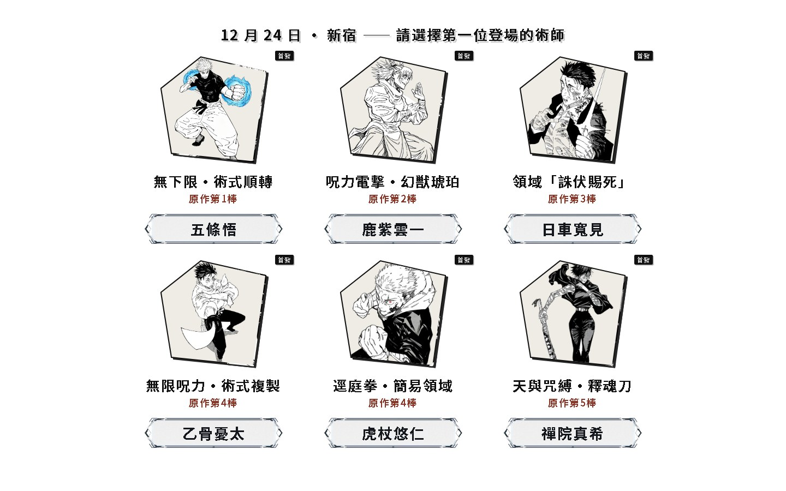
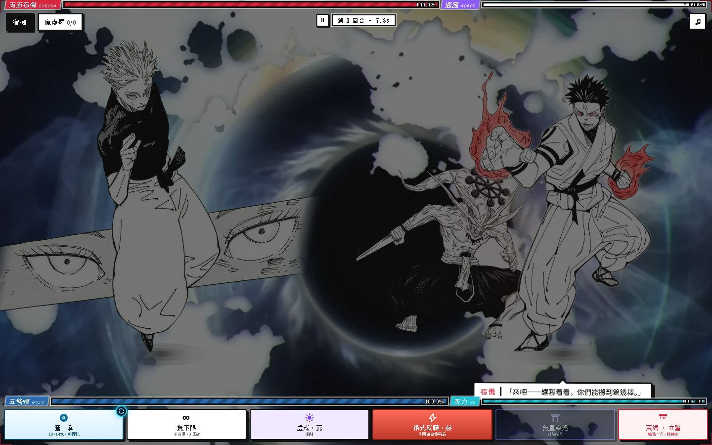

# 人外魔境 · 新宿决战

**五条悟 vs 宿傩。回合制，可以自己上手打。单个 HTML 文件 —— 打开就能打，断网也能打。**

[▶ 在线试玩](https://jjk-shinjuku-battle-83982.app.workbuddy.host/)　·　[⤓ 下载单文件](https://github.com/linziyang777/jjk/raw/main/index.html)　·　48 MB　·　零依赖

> 试玩走的是国内节点。同一份文件也发布在 [GitHub Pages](https://linziyang777.github.io/jjk/)，海外访问反而更顺；国内打开要等几分钟——48 MB 摆在那儿，绕不过去。

↑ 无头 Chrome 真实跑出来的录像，不是概念图：蓄力 → 集中线 → 招式大字「八握剣」→ 全屏变色 → 伤害结算。560×350，5 秒，2.3 MB。

## 这是什么

《咒术回战》新宿决战的同人二创，做成能上手操作的对战。挑一名术师，轮流出招、格挡、攒咒力开领域，在 QTE 里赌一发黑闪。对面那位是宿傩。

六名可操作角色，招式、领域、语音各不相同。

## 长什么样

  
  
  

选人 → 登场 → 战斗（宿傩血量跌破 90% 会召出魔虚罗）

上面那张 GIF 同样出自这一局：无头 Chrome 打开 `index.html`，跳过开场影片、选五条悟、连点八招，逐帧抓下来再编码。全流程没有一点人工摆拍。

## 参战角色

| 角色 | 术式 | 奥义 |
|---|---|---|
| 五条悟 | 术式顺转·苍 / 苍·拳 | 虚式·茈 |
| 鹿紫云一 | 术式顺转·放电 | 幻兽琥珀·解放 |
| 日车宽见 | 法槌·开庭 | 处刑人之剑 |
| 虎杖悠仁 | 迳庭拳 | 赤血操术·穿血 |
| 乙骨忧太 | 太刀·咒斩 | 领域·真赝相爱 |
| 真希 | 释魂刀 | 无声突袭 |

## 怎么玩

- 选角色 → 选难度 → 开打。出招、格挡、攒咒力，够了就开领域。
- **黑闪**：出招有 8% 概率触发（虎杖 14%），连续黑闪每次 +3%，最高 +15%。金色计量条点中时，该击伤害 ×2。
- **完美格挡**：宿傩出招前有黑色预警，按下防御的那一刻判定——时机准就「完璧」架开，下回合行动力 +1。
- **五条悟 1 技双形态**：苍（可挂引力标记，配合「赫」引爆）⇄ 苍·拳（伤害翻倍），右上角角标随时切换。
- **无下限·不可侵**：五条 2 技，三回合内一切攻击在身前停住；魔虚罗登场后「适应」两回合即破解，一技自此固定为「苍·拳」。
- **处刑人之剑**：日车大招命中必没收——首击夺走宿傩的「神武解·电击」，此后每一击再随机没收一招。被夺走的技能本局不可再用，宿傩只能从剩下的招式里随机出手。
- **魔虚罗**：宿傩生命掉到 90% 以下之后会召唤出来；同一技能第 3 次起对它完全无效，必须轮换。
- **世界斩**：宿傩原身形。首斩不念咒词、直接落下；此后每次都要先读满五段仪式（阎魔天掌印 → 龙鳞 → 反发 → 成双之流星 → 定向），读条回合他不攻击，但仪式满了就必杀当前术师——包括在别人领域里用弥须葛笼或反转术式护身的那些回合，他照样能读。
- 结算页给一套完整的战报：接力链、回合数、黑闪次数、结局图鉴、成就，以及全服战况（多少人挑战过、多少人真打赢了）。
- 电脑端 **空格** = 暂停 / 继续；手机端点暂停字样也能继续。
- 手机端自动适配横屏比例，竖屏会转过来铺满。

## 技术说明

- 一个 HTML 文件：结构、样式、逻辑全在里面。
- 全部图片（抠图立绘 / 墨痕 / 特效）、十余段语音与音乐、开场影片，统统 base64 内嵌。**运行时没有一次外部请求。**
- 无框架、无构建工具、无 CDN、无字体外链。
- 代价是 **48 MB**：第一次打开要等它整个下完。换来的是一份文件拷走就能跑，断网照玩。
- 网页版额外有一条轻量的战况统计（挑战人次 / 通关人数 / 手感反馈），只发几个数字，不影响单文件本体；下载后离线玩则完全不联网。
- 托管在 GitHub Pages，国内主节点另有一份。

## 本地打开

下载 [index.html](https://github.com/linziyang777/jjk/raw/main/index.html)，双击。不需要服务器，不需要联网。

## 同人声明

非商业同人作品。角色、世界观与原作设定版权归芥见下々 / 集英社所有。本项目仅供学习与技术交流，不用于任何商业用途。如有侵权请联系删除。

## 更新记录

版本已经迭代到 **v243**。挑几条大的：

- `v160` 开场影片 + 落地页重做
- `v174` 开场影片声音修复，处理浏览器自动播放拦截
- `v181` 特效重做：「捌」赤红针芒、「解」墨痕刮过、虎杖「灵魂·解」
- `v222~225` 真结局（虎杖击倒宿傩）、仪式条逐段点亮、语音人声分离
- `v228~230` 完美格挡重做（黑色预警 + 行动力 +1）、五条数值上调、结算页重做
- `v231~233` 五条 1 技双形态「苍·拳」瞬身演出 + 切换角标、「无下限·不可侵」、穿血射流细化
- `v234~235` 式神血条行搬左上角（暂停不挡菜单）、登场动画背景重设计
- `v236~238` 反转术式框色修正、结算页白底可滑动、日车「处刑人之剑」没收机制
- `v239` 结算页加入全服战况与三档手感反馈（网页版）
- `v240` 结算页改左右两栏一屏呈现、纯白底、成就横向轮播；通关只留「你已掌握咒力的核心」；选人页取消滑动、暂停点字即续、苍·拳加打击音、乙骨咒力波改不规则墨勾边
- `v241` 宿傩在他人领域内不攻击的回合（弥须葛笼 / 反转术式）也能读仪式条，概率与普通回合一致
- `v242` 机制修正与体验优化：① 无下限被魔虚罗破解后，反转术式去除「血量低于 40% 才能使用」限制（技能框改回白底，已同步 APK）；② 宿傩「解」动画改为自右向左横扫、穿过玩家；③ 宿傩原身状态额外 +1 次领域对拼机会；④ 修复乙骨领域在魔虚罗已死、对拼已赢后仍自行破裂；⑤ 困难模式下宿傩每次可拼都触发对拼（不受次数上限限制，但处刑人之剑没收 / 熔断等封印门仍生效），且对拼胜率降为 70%（虎杖领域仍 100% 胜利）；⑥ 修复术师刚登场就被麻痹；⑦ 邪去悔梯子讖字缩小避免遮挡技能框，并新增出现时光柱自天而降的演出（播放时暂停倒计时）。后台历史战况已合并累计
- `v243` 体验与修复：① 无下限「2 回合」改用绝对回合戳（不再一登场就失效），术式熔断时 2 技固定为反转术式，解除「熔断却用不了反转」；② 「解」改浅斜角水平横扫至最左；③ 乙骨领域彻底不受魔虚罗外側击碎；④ 虎杖 / 鹿紫雲一独立入场也清麻痹，并加「世代号」防延迟命中把麻痹套到新角色；⑤ 「捌」删针芒，改为多道赤红斩击直接落在玩家身上（快·大·顿挫）；⑥ 黑闪音效提前到技能打出瞬间并预加载；⑦ 里香取消血量、不可被杀死，5 回合或咒力解放后退场并失去「模仿术式」，召回冷却 4 回合；⑧ 角色阵亡对白改黑屏演出（白字居中轮播、点击跳过）；⑨ 关闭音乐后领域 BGM / 语音不再响，静音状态持久化；⑩ 邪去悔梯子字图缩小、天降光柱加大加粗；⑪ 电脑端结算页居中修复；⑫ 麻痹时宿傩在倒计时剩 5 秒即出手；⑬ 式神血条行下移留空隙
- `v243b` 日车「法槌·开廷」「处刑人之剑」动画加速（1.15→0.78s / 落剑 1000→690ms）；修复五条悟「术式公开」束缚的「茈 ×1.8」在「无限制·茈」路径完全不生效；按需求直接移除方向键（信息洪流）玩法，领域仅保留每回合 5% 侵蚀与封锁

---

同一个人做的：[林子炀 · 作品集](https://linziyang777.github.io/)

觉得有意思的话，点个 star 就好。
