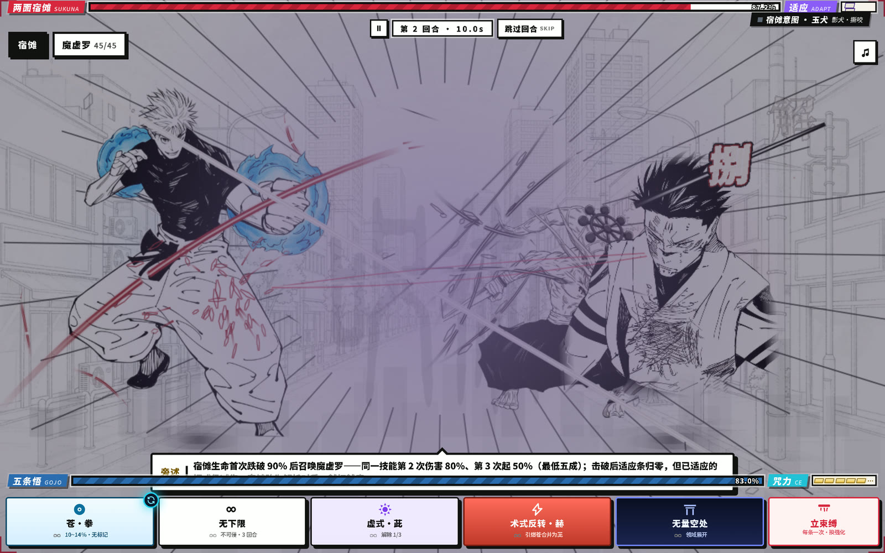
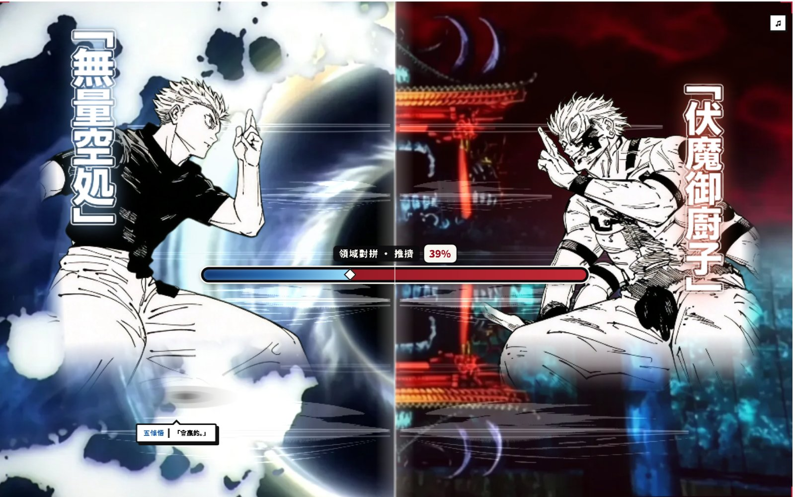
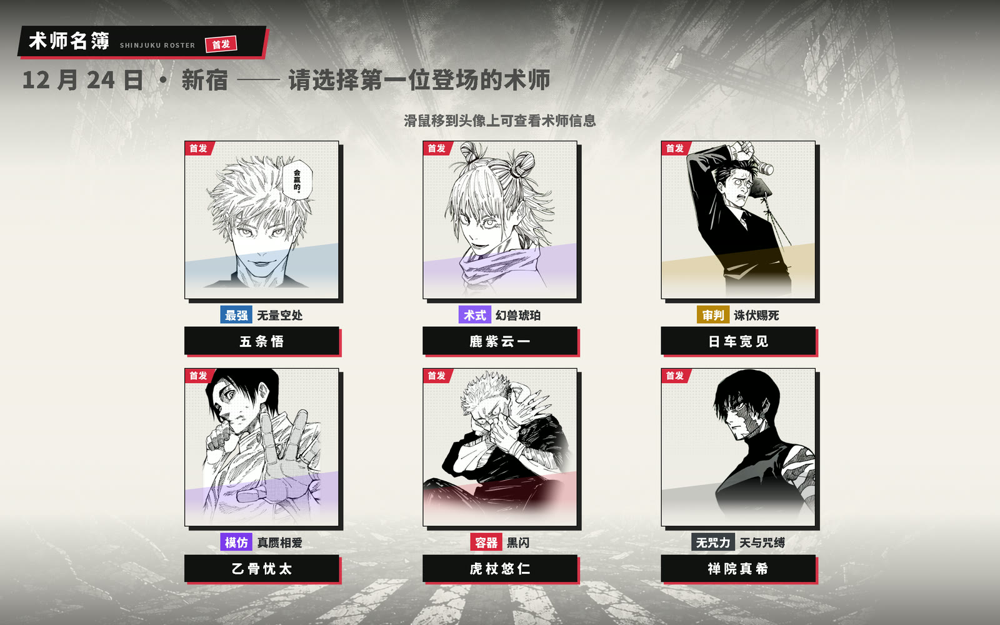
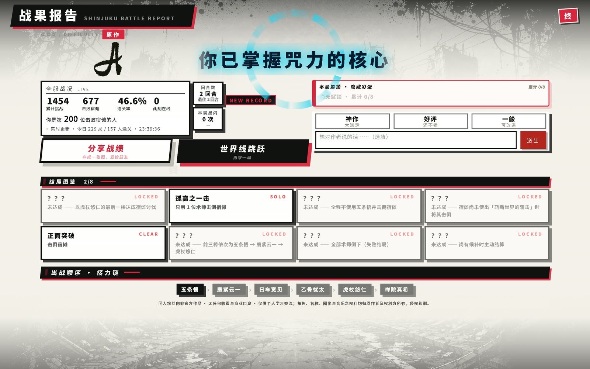

# 人外魔境 · 新宿决战

**五条悟 vs 宿傩。回合制，可以自己上手打。在线版即开即玩。**

[▶ 在线试玩（GitHub Pages 镜像）](https://linziyang777.github.io/jjk/)　·　零依赖　·　无需安装

> **国内直连（推荐，腾讯云节点、无第三方跳转）**：`https://jjk-shinjuku-battle-83982.app.workbuddy.host/?sharecode=HV2H7J6CIV`
> 方便转发的短链（走 Cloudflare，境内偶发连不上）：`https://tinyurl.com/jjk-shinjuku`
> 该沙箱节点会休眠，打开慢或报连接失败时**刷新一次**（冷启动约 3–8 秒）即可；长期不稳就用 GitHub Pages 镜像。

> 在线版已做资源拆分：HTML 仅 1.5 MB，图片 / 语音 / 影片拆到**同目录的 `assets/`** 并行加载，首屏秒开、运行更顺，画质音质零压缩。
>
> 仓库只保留在线版。单文件离线包（66 MB）会把整站首屏拖成一个巨型文档，不再随仓库发布——需要离线版请向作者索取 `新宿决战.html`（双击即玩，断网可跑）。

  

第 2 回合 —— 苍·拳砸中宿傩那一下，红字 −16% 是实际伤害；宿傩血条下那三枚白底墨框是本回合在场的单位（本体 / 魔虚罗 / 颚吐），右上角写着他下回合要用的「斩击 · 近身 · 单体」，紧挨着意图框的那枚音符小钮是音乐开关；技能框上沿的小数字，就是这一招要花的点数

## 这是什么

《咒术回战》新宿决战的同人二创，做成能上手操作的对战。挑一名术师，轮流出招、格挡、攒点数开领域，在金色计量条里赌一发黑闪。对面那位是宿傩。

六名可操作角色，招式、领域、语音各不相同；宿傩会换形态、召式神、读世界斩，也会在被打空血之后现出四臂二面的原身。

当前版本 **v575**：**黑闪**换了写法 —— 去掉黑底横条，改成墨黑字身（`#040000`）＋朱红描边（`#C20001`），五条悟「苍·拳」、乙骨「太刀·呪斩」、束缚「黑闪之束缚」三条路径统一成同一套演出；**虎杖打出黑闪会把宿傩打成「硬直」**，那一回合宿傩本体无法发动攻击（场上式神照常行动），状态列会亮出「宿傩·硬直」；「行动力 +1」的提示从立绘右肩挪到了玩家名字正上方。

更早几版打的地基：全站伤害与血量统一以「玩家满血 = 100」为基准显示，数字和说明对得上；血条读数放大到任何屏幕都看得清，咒力与适应条改成横向格；出招成本一眼数得清（1 格 = 20 咒力，上限 5 格，**每回合回 2 格**；真希的体力同理）；立束缚不消耗行动；宿傩下回合要做什么提前写在血条右边；读秒右边有「跳过」；血条被打空会放慢定格再进死亡演出。另有领域大字繁体化、五条终幕提前到击杀前、双方无法行动时倒计时剩 5 秒就结束回合等节奏与界面调整。

界面这版也做了一轮降噪：状态徽标从四套颜色收成「红＝正在受伤 / 墨＝其余」两档，单行最多 5 枚、多出的折成 `+N`；宿傩被夺走的招式从七条竖排黑标签收成一枚「已失效 N」徽章，点开才铺开。手机上真希的龙骨仪表移到血条上方，状态徽标与式神行上移贴住宿傩血条，音乐键缩成小圆钮挂在意图框正右侧。

顺手收拾了几处「按了没反应」和「打错了人」：暂停键在战斗中偶尔点不动（整条 HUD 压在回合栏上），世界线跳跃点了不回难度页——同一个原因，已让 HUD 整层点击穿透；宿傩召出贯牛时，虎杖径庭拳的二段追击、完美格挡追击会连带把伤害算到宿傩头上，现在一律只落在你锁定的那个目标上；黑闪原声原本要等音频解码，判定成功后约迟半秒才响，现在读条一开始就备好，点中即响。GitHub Pages 镜像的资源也改回了同源分发，部分立绘 / 领域图丢失、登场动画卡住的问题一并消失。

更近的几版还做了：致命一击的三段变速慢放（0.62 秒定格 → 0.10 极慢 → 缓升回常速），黑屏独白推到慢放结束之后，期间点屏可跳过；
「灵魂·解」改成先划出漫画式裁断线（虚线＋剪刀），剪断后才炸开不规则斩痕，斩痕方向与虚线错开约 60°；宿傩的「捌」拆成聚／射／炸／余四段。
领域音乐加了按状态核对补播的机制 —— 宿傩、乙骨、五条、虎杖四条领域曲即使某次回调被语音闸门挡下，也会在 0.9 秒内自己补上；
背景的「呪術」字样缩小成低调底纹，技能小字不再重复标注咒力点数（按钮上沿的点数徽标已经表达消耗）。

最近这批只改了特效：宿傩的「捌」清掉了同帧混入的「解」墨线与裂口，整段只剩赤色收束／贯穿／斩网／焦痕；
「解」缩短成不到一屏，靠出招方的一端做渐隐虚化，交叉锚点移到玩家立绘中心；每次随机出 1～2 道，
两道时以玩家身上为交点拉开随机张角（总夹角约 30°～80°），每道角度不同。

最近一轮还修了性能与台词：标题／选人／结算层盖着时跳过整条渲染并清画布（不再在选人页闪出对战画面）；开场影片自动播放被拒时不再干等；虎杖一技能冲刺的尾段插值加快；「解」缩短、随机 1～2 道且在玩家身上交叉；对话气泡移到顶层、按战斗节奏自动加速，并删除开局那条空白旁白泡。

## 长什么样

  

领域对拼：五条悟的「无量空处」与宿傩的「伏魔御厨子」正面对撞，中间是推进条 —— 谁的结界更精密，谁就碾过对方

    
    
    
  

  
选人 → 战斗 → 结算（结算页有接力链、结局图鉴、全服战况与手感反馈）

以上为 v565 的实机画面，无头 Chrome 打开本地 HTML 直接抓的，没有后期合成，也没做美术修饰。

## 参战角色

| 角色 | 术式 | 奥义 |
|---|---|---|
| 五条悟 | 术式顺转·苍 / 苍·拳（可切换双形态） | 虚式·茈 |
| 鹿紫云一 | 术式顺转·放电 | 幻兽琥珀·解放 |
| 日车宽见 | 法槌·开庭 | 处刑人之剑 |
| 虎杖悠仁 | 迳庭拳 | 赤血操术·穿血 / 领域 |
| 乙骨忧太 | 太刀·呪斩 | 领域·真赝相爱 |
| 真希 | 释魂刀 | 无声突袭 |

## 怎么玩

- 选角色 → 选难度 → 开打。三档难度：**原作**（6 位术师）／**苦战**（3 位）／**绝境**（2 位，宿傩伤害 ×2.2、我方输出 ×0.6、7 秒回合、适应常驻）。出招、格挡、攒点数，够了就开领域。点首页的「術式公開」可以翻完整的战斗规则（分角色技能 / 机制 / 数值）。
- **点数就是出招成本**：技能框上沿那个黑色水滴里的数字，就是这一招要花几点；1 格 = 20 咒力，上限 5 格、每回合回 2 格，不够就按不动。五条悟走「六眼」，全技能 0 点（显示 ∞）；乙骨里香在场同样 ∞；真希没有咒力，这一条改看体力。
- **立束缚**：每棒都能免费立一条束缚换收益，不占行动。共 18 条——术式公开、黑闪、魂斩·一闪、限界放电、魂之境界、辩护人、静寂、天与咒缚、魔眼、里香反伤、不屈……有纯加成的，也有拿血量上限或承伤去换的；条款与代价都写在首页「術式公開」里。
- **宿傩的意图**：血条右侧这一回合会提前标出他要干什么（普攻 / 领域 / 式神 / 世界斩），照着这条信息决定格挡还是抢输出。
- **跳过**：读秒右边的按钮可以直接把这回合过掉，用来抢节奏；没用完的行动力会补进下回合。
- **界面怎么看**：宿傩血条下方那排小标签是你的状态——**红框＝正在伤到你**（脆化 / 燃烧 / 苍标记 / 灵魂损伤），白底墨框＝其余（术式公开、束缚这类）；超过 5 枚会折成 `+N`，点一下临时展开、6 秒后自己收回。**「已失效 N」**是宿傩被夺走 / 被抹掉的招式，点开才铺出清单。音乐开关缩成音符小钮，挂在宿傩意图框右侧。
- **致命一击**：血条被打空的那一下会定格放慢，等演出走完才进下一步，不会「莫名其妙就结算了」。
- **黑闪**：五条悟「苍」8%／「苍·拳」13%／虎杖「径庭拳」14%／乙骨「太刀·呪斩」8%，**每引发一次 +5%、上限 +15%**（整棒累计，不随回合清零）。金色计量条点中时，该击伤害 ×2。虎杖打出的黑闪还会把宿傩打进**硬直**：那一回合他本体无法攻击，场上式神照常行动。
- **完美格挡**：宿傩出招前有黑色预警，按下防御的那一刻判定——时机准就「完璧」架开，下回合行动力 +1。
- **五条悟 1 技双形态**：苍（可挂引力标记，配合「赫」引爆）⇄ 苍·拳，技能框右上角角标随时切换；血量不满时立绘会换成蓝焰拳姿。
- **无下限·不可侵**：五条 2 技，三回合内一切攻击在身前停住；魔虚罗登场后「适应」两回合即破解。
- **术式熔断与反转术式**：领域对拼输了就熔断，除反转术式外全封；反转术式回 25% 生命、修好熔断，还能让「无量空处」多开一次（本局上限 2 次）。演出播完宿傩才会出手。
- **领域寿命**：只要魔虚罗还在场上，五条的无量空处与乙骨的真赝相爱都撑不过两回合——第 3 回合开始时裂纹会先一步爬满结界的边缘。想保住领域，得先解决魔虚罗。
- **乙骨的模仿术式**：里香在场时二技能变成「模仿术式」，池中五招随机抽取 —— 赤血操术·穿血（15~20%）／言灵术式／宿傩的「解」／宿傩的「捌」／邪去侮天梯（10~15%，领域里那次同样结算）。除言灵与天梯，每招冷却 1 回合、冷却好自动轮换下一招；言灵能定住宿傩一回合并给自己多一次行动，天梯则永久抹掉宿傩一个常规技能。**言灵与天梯（领域里那次除外）全局各只能用一次**，用过就从池子里永久消失。
- **处刑人之剑**：日车大招命中必没收——首击夺走宿傩的「神武解·电击」，此后每一击再随机没收一招。被夺走的技能本局不可再用，结算页会列出「已失效」清单。
- **魔虚罗**：宿傩生命掉到 90% 以下之后会召唤出来；同一技能第 3 次起对它完全无效，必须轮换。**魔虚罗一旦登场，适应就永久留在宿傩身上——打掉它也清不掉了。**
- **世界斩**：宿傩原身形。首斩不念咒词、直接落下；此后每次都要先读满五段仪式（阎魔天掌印 → 龙鳞 → 反发 → 成双之流星 → 定向），读条回合他不攻击，但仪式满了就必杀当前术师。
- 结算页给一套完整战报：接力链、回合数、黑闪次数、结局图鉴、成就，以及全服战况（多少人挑战过、多少人真打赢了）。
- 电脑端 **空格** = 暂停 / 继续；手机端自动适配横屏比例，竖屏会转过来铺满，结算页可直接上下拖动。

## 技术说明

- 双形态发布：**在线版**把结构 / 样式 / 逻辑留在 `index.html`（1.5 MB），全部图片（抠图立绘 / 墨痕 / 特效）、二十余段语音与音乐、开场影片拆到同目录的 `assets/`，与页面**同源**分发——页面能打开，资源就一定能拿到；**离线安装包**则是把所有资源重新 base64 内嵌回单文件，断网双击即玩，仅线下分发。
- 无框架、无构建工具、无字体外链。角色与特效走一块 `canvas`，HUD、技能栏、结算页是 DOM。
- 在线版首屏只需下载 1.5 MB 的 HTML，图片 / 音频 / 影片从同源 `assets/` 并行拉取并落浏览器缓存：资源名就是内容哈希，永不脏读；Service Worker 命中后，同一个域名下即便断网也能继续玩。
- 性能上做了自动降载：帧率掉下来、或场上特效超过 16 个时，自动关掉最贵的 `shadowBlur`；同时限制同屏特效数量，并按帧率自适应降低渲染分辨率。
- 网页版额外有一条轻量的战况统计（挑战人次 / 通关人数 / 手感反馈），只发几个数字，不影响单文件本体；下载后离线玩则完全不联网。
- 安卓端另有一份打包好的 APK（同签名可直接覆盖安装），在[国内直连节点](https://jjk-shinjuku-battle-83982.app.workbuddy.host/download?sharecode=HV2H7J6CIV)下载。该节点是沙箱容器，会休眠：首页打不开时刷新一次（冷启动 3–8 秒）通常就恢复；长期不稳就用 [GitHub Pages 镜像](https://linziyang777.github.io/jjk/)。

## 本地打开

需要离线玩：浏览器直接打开在线版即可（有 Service Worker 缓存，二次访问离线也能进）；要整包带走就下载 `新宿决战_网页版.zip`（`index.html` + `assets`）或 Android 版 `app.apk`。66 MB 的桌面单文件大包已停止维护。

## 同人声明

非商业同人作品。角色、世界观与原作设定版权归芥见下々 / 集英社所有。本项目仅供学习与技术交流，不用于任何商业用途。如有侵权请联系删除。

## 更新记录

对外版本 **v6.5 · build v575**，构建号以游戏内自检与 `/api/ver` 为准（显示号＝真实构建号，不再统一显示 V520）。进游戏时若发现是新版本，会弹一次「已更新」提醒（每个版本只弹一次，可手动关掉）。

**v575 · 黑闪改墨字朱红描边 / 虎杖黑闪打出硬直 / 行动力提示移到名字上方**

- **黑闪大字重做**：原来的渲染是一块 416×156 的黑色横条压着红字，会整块盖住宿傩。现在撤掉底条，只留墨黑字身（`#040000`）＋朱红描边（`#C20001`），字后一层极淡的朱红爆量晕，白纸背景上读得出笔锋。
- **所有黑闪文字统一**：五条悟「苍·拳」、乙骨「太刀·呪斩」、束缚「黑闪之束缚」原本各自用 `fxText` 画一行红字，现在全部走 `fxManga` 的同一套烘焙演出，四处的字重、字距、描边完全一致。
- **虎杖黑闪 ⇒ 宿傩硬直**：虎杖对宿傩打出黑闪时，宿傩被打得踉跄，**当回合本体无法发动攻击**（不召式神以外的动作、不读世界斩、不出手预告），场上式神照常行动。状态列新增红框「宿傩·硬直」，下一回合自动退。
- **「行动力 +1」提示换位**：从玩家立绘右上肩挪到左下角玩家名字的正上方，不再和苍的引力锚点、咒词抢位置。
- **规则页按实际结算重写黑闪条目**：补上「苍·拳 13%」「乙骨 8%」、注明连锁 +5%／上限 +15% 是整棒累计；删掉旧文案「完美格挡必定引发黑闪（追击黑闪 ×3）」—— 这条收益在 v229 就撤了，现在完美格挡给的是必定架开、仪式回退 1 段、下回合行动力 +1。
- **四个渠道同版**：网页、GitHub Pages 镜像、安卓 APK、离线网页版 zip / B 站 TOY 包全部升到 v575（同签名可直接覆盖安装）。

**v571 · 数值条可读性 / 格条改横向 / 无限咒力留白 / 去百分号 / 一阶段领域立绘**

- **数值条看得清了**：小窗口下 UI 紧凑系数会把血条压到十来像素、读数只剩 6px，3px 描边再吃掉一半，等于看不清。现在条高与读数都设了像素下限（血条 ≥22px、细条 ≥17px、读数 ≥12.5px），并加深读数背后的墨底（满血条红底、咒力条蓝底），任何窗口尺寸下数字都读得出来。
- **格子改成横向增长**：咒力与适应条此前换行堆叠，看起来是「竖着长」。现在强制单行横排、每格等分，5 格从左到右铺满，消耗几格一眼数得出来。
- **无限咒力不再灰填充**：五条「六眼」、乙骨里香在场时，读数元素的墨底会被拉满整条、看着像一块灰条。现在条底改纯白、读数背景透明，只剩中央一枚 ∞。
- **百分比改为纯数字**：技能栏小字、命中飘字、选人页说明、适应读数共 27 处「10~14%」这类写法去掉百分号，与「玩家满血 = 100」的口径一致；只有相对增减（受伤 −35%、命中 +5%）仍保留百分号。
- **一阶段宿傩领域对拼换立绘**：此前只有原身阶段会切对拼特写，一阶段一直是普通站姿（判断条件引用了一个从未被赋值的计时字段，等于永不成立）。现在一阶段对拼也切「一阶段领域展开」立绘（双手结印特写），原身仍是全身对拼姿。
- **引导页残留图形删除**：新手引导时画面里那片多余的黑叶子，其实是一枚内容被清空、只剩边框与尾巴的对话气泡。现在空文本时气泡整块隐藏。
- **四个渠道同版**：网页、GitHub Pages 镜像、安卓 APK、离线网页版 zip 全部升到 v571（同签名可直接覆盖安装）。

**v569 · 结算页回顶钮补回 / 敌方出手排位次 / 束缚重开后可用**

- **结算页「向上」按钮补回**：旧版只在「已经滚到最底」那一下才出现回顶按钮，实机上常常永远触发不到，看起来就是「只有向下的，向上的丢了」。现在只要往下滚过一点就换成回顶，桌面／竖屏／横屏一致。
- **敌方出手有了顺位**：宿傩打完 → 颚吐 → 魔虚罗 → 圆鹿之愈，逐拍出手；单位之间留出约一拍的空隙，斩击特效播完才轮到下一位，出手时带 ①②③ 位次标注。此前式神在宿傩出手的同一帧全部放出去，两只式神会一起扑上来。
- **束缚重开后可用**：修掉「立过一次束缚 → 世界线跳跃重开 → 那个位置的束缚全部变灰、点了没反应」。世界线跳跃（结算页与暂停页两条入口）都会把束缚状态整段归零，`本棒已立 / 本回合已立` 改为按当前术师判定，面板缓存一并清空。
- **同回合重复立束缚会给出提示**：原先点了完全没反应，现在明确提示「这个回合已经立过束缚了」。

**v568 · 数值口径统一 / 语音不再被掐 / 立绘与界面微调**

- **全站数值一个基准**：所有伤害、回血、血条读数统一按「玩家满血 = 100」换算，宿傩原身第二管从 100 续到 150，飘字与血条文本同一套函数，文案写的数就是结算的数（去掉了此前的百分比符号与隐藏倍率）。
- **死亡语音不再被跳过掐断**：死亡三句（3.28 / 2.50 / 0.78 秒）按真实时长结尾，期间点屏跳过演出也不会把语音半路归零；语音在念时全局静音操作一律让行。
- **领域曲不被技能语音顶掉**：宿傩领域展开期间，场上技能语音与另一首额外 BGM 都不能把领域曲挤掉；被意外暂停会当场认回继续播。
- **魔虚罗换尺寸基准**：立绘改按「高度」定尺寸，不再被宽度上限压扁，八握剑异戒神将的体量与场上角色比例正常。
- **界面**：咒力 / 体力水滴上的数字下限放大到可读；技能「生效中」只留右上角小角标，不再套一圈金框；无限咒力时格子全空、中央显示 ∞。
- **咒力回复**：每回合一次直接给 2 格，不再按秒爬。

**v565 · 双方空转保护 / 终幕提前 / 界面与节奏**

- **宿傩无法行动不再空转**：无量空处内附身形态、言灵定身、灵魂定身等情况下，玩家出完招后倒计时剩 5 秒就结束回合，不再两边都动不了却空等读秒；与玩家无法行动时宿傩剩 5 秒出手对称。
- **五条悟终幕提前**：能击杀宿傩的那一击之前先播终幕演出，再正常击败进入胜利对白 —— 同虎杖的钉崎共鸣动画那样先演出、后结算。
- **领域展开大字**：改繁体「領域展開」，字号略减、位置上移，不遮玩家立绘；删去乙骨退场时「剑林散去」那句对白。
- **资源经济**：每回合咒力 / 体力恢复 1 格 → 2 格；乙骨反转术式 3 格 → 2 格。
- **界面微调**：咒力条改蓝 `#0485F2`、勾边 `#000415`；消耗标记内部改青蓝渐变、数字白色显眼；行动力 +1 改白字黑勾边、贴在玩家立绘右上角。
- **音频**：领域对拼双语音小幅错开、同时念且各自完整念完；角色死亡时宿傩三句语音不再被 BGM 盖尾。
**v539 · 领域行动力可见化 / 回合等表演 / 慢放缩短**

- **额外行动力终于看得见**：领域展开拿到的第 2 次行动，现在会砸出一行金色「行动力 +1」，右上角胶囊同步变成 ×2；技能栏解锁的那 0.52 秒里提前点的技能不再被静默吞掉，而是先记账、解锁瞬间自动补发。
- **回合要等表演结束**：宿傩与在场式神的攻击动画全部播完之后才推进下一回合 —— 技能栏重新亮起、能再点技能的那一刻，才是你出手的时机。
- **领域对拼两句台词都念完**：五条悟先念（0.05–4.15 秒两段），宿傩从 4.25 秒接着念，不再同帧抢麦；回合按视觉节奏推进，尾音留在背景。
- **仪式条不再压住顶栏**：阎魔天掌印那条进度条出现时，左侧标记、右上音乐按钮、回合倒计时一起自动下移（实测让位 26px）。
- **致命一击慢放压缩**：定格 0.30 秒 + 约 1 秒三段变速即进入死亡演出（原 ~3.3 秒），保留顿挫感但不至于反应不过来。
- **手机端结算两处修复**：世界线跳跃按钮改三路事件绑定（夸克 WebView 的合成点击也能触发）；下移箭头改按「触屏 / 窄视口」判定并加 inline display 兜底，不再丢失。
- **规则页同步**：「战斗规则」里补上回合真正开始的判定与行动力提示。
**v535 · 命中反馈与「白芒」重做**

- **去掉墨爆**：命中时那团 AI 墨迹贴图不再绘制（两张贴图的预载也一并摘掉），只留中心一下白闪，画面不再被墨块糊住。
- **白芒加了黑色不规则勾边**：斩中那一瞬的白色亮条外面套一圈手勾味毛边墨线，每次斩击形状都不同；浅色立绘画面上也读得清。
- **白芒放大**：它代表「一刀」，长度与厚度各 ×1.5、停留 0.20→0.26 秒，一眼看得出是斩击而不是闪光。

**v520 · 玩法、节奏、界面与音频的一轮集中收口**

- **出招成本改成「点数」**：以前是一条 0~100 的咒力条，看不出这一招到底花多少。现在技能框上沿的水滴里直接写点数，1 点 = 20 咒力、上限 5 点、每回合回 1 点；不够时按钮变灰，按不动就是按不动。五条悟「六眼」全技能 0 点（显示 ∞），乙骨里香在场同样 ∞，真希没有咒力、这一条改看体力。HUD 也从长条改成五格方块，格数就是点数。
- **立束缚不再消耗行动**：每棒免费立一条，18 条条款按「净收益 +8~+15、机制型最多 +25」的尺子重做，不再有「一次性收益挂永久代价」那种亏本买卖。黑闪之束缚、魂斩·一闪改成两回合脆化（受伤 ×1.3 / ×1.2）；限界放电自损 20 → 10、魂之境界 4% → 2.5%、天与咒缚 1.45 → 1.55；魂之代偿、魂之绊明确要押血量上限（卡面直接标「上限 −50%」）。条款细节与帮助页同步重写。
- **宿傩的意图条**：玩家回合就能看到宿傩这回合要做什么（血条右侧那一行），信息在掷出那一刻就锁定，宿傩回合直接复用，不会临时改口。战斗真正变成「看着对面出牌再决定怎么打」。
- **回合改成三段**：回合横幅 → 读秒 → 出招，横幅期间读秒冻结、顶部计时条退场，动画演完才轮到玩家；选人页也不会再提前冒「第 1 回合」。
- **跳过**：读秒右侧新增按钮，可以直接把这回合过掉，没用完的行动力补进下回合。
- **致命一击慢放**：血条被打空的那一下定格 0.62 秒、全局慢放到 2.6 秒并弹「致命一击」，退场演出也从 2.6 秒撑到 4.1 秒——「怎么突然就结算了」的观感基本消掉。
- **影遁只护本体**：影遁回合打贯牛 / 魔虚罗 / 颚吐不再被同一道幕拦下（此前的拦截写在「目标转给式神」之前，打式神也被吞）。
- **界面**：背景咒字缩小并换成开场那枚图案、结算页「终」水印收窄到不再顶掉 CTA、顶部回合条改整行三栏（暂停左 / 读秒正中 / 跳过右）、场地破坏与适应条格化、宿傩血条加宽、意图条移到右端。
- **音频**：开场影片、首页、选人统一用普通战斗曲，全程不换源、不重播，进战斗登场才切角色曲；修夸克 / UC 语音抢播、BGM 三条死锁；开场影片元素压到 2px 并加 `x5-video-player-type`，不再被接管成原生播放器。
- **入场**：立绘 data URI 先 `decode()` 预热再起播，慢机器不再卡在「立绘没出来」；开场视频的会话去重窗口从 30 分钟收到 8 秒，刷新就能重看。
- **界面降噪**：状态徽标从红 / 紫 / 金 / 橙四套色收成两档——红框只给「正在伤到你」的状态，其余一律白底墨框；单行最多 5 枚，多出的折成「+N」，点开临时看 6 秒。宿傩「已失效」清单也从 7 条竖排黑标签收成一枚「已失效 N」徽章，点开才横排铺开。
- **手机 HUD 归位**：真希的龙骨 / 灵魂损伤仪表移到血条上方；状态徽标与式神行上移、紧贴宿傩血条下缘并按可用宽度自动夹断；跳过按钮去掉「回合」二字保证单行；已失效清单挂进底部 HUD 上沿，条目再多也不压玩家血条与咒力条。
- **意图框与音乐键**：宿傩意图框与上方血条之间留出 7px（手机）/ 12px（桌面）空隙，音乐键缩到随屏缩放、摆到意图框正右侧，右缘与血条右端对齐。
- **BGM 更早**：起播点从「开场影片开始」提前到开场「呪」字描边动画，重试窗口不再只认「影片播放中」，载入阶段不会再一路静音到文档解析完。
- **呪斩**：乙骨一技能统一写作「呪斩」，按钮名、出招飘字、帮助页、图鉴同源，不再出现按钮写「咒」、画面写「呪」。

**v508 · 夸克 / UC 语音静音与 BGM 死锁**

- 语音预热用 `muted=true`、正式起播却只设音量不摘静音 ⇒ 解码慢的那一句整段无声。改为预热 / 正式分元素状态隔离，起播无条件 `muted=false`。
- `switchBGM` 先 `pause()` 再换源、`extraBgmKey` 残留导致 `startBGM` 永久早退、`resumeMainBgm` 在语音闸门期直接 return —— 三处死锁一并修。

**v507 · 领域对拼语音固定「玩家略先、几乎同时」**

- 手机上曾变成「先宿傩、后五条」：首次展开时两句 solo 音轨都是现场 `cloneNode` 且未解码，`play()` 要等解码或 150/420/1200ms 重试，宿傩文件小、重试时机靠前就抢先出声。
- 改为 `preClashVoices()` 在首次用户手势就用 `domMkEl` 预建三条 solo 音轨并静音空跑预热（真正完成解码缓冲）；宿傩起播由玩家语音的 `playing` 事件同步触发，不再依赖会被手机节流的短 `setTimeout`；保留 1200ms 兜底放闸。
- `domainAudioBegin()` 去掉会与正式 `play()` 抢状态的 `unlockVoiceEls()` 调用。全渠道统一到 `v6.5 · b507`。

**v506 · 手机端领域对拼语音 + GH 竖屏加载层**

- 关掉无头的免手势特权后实测：两句领域语音都停在 `paused / 0s`——`play()` 被自动播放策略拒绝后只被静默吞掉，且 solo 音轨是**从未插入 DOM 的游离元素**（iOS / 夸克 U4 对此限制更严）。改为常驻隐藏宿主 + 领域展开瞬间静音空播解锁 + 被拒时静音解锁重播；就绪事件补 `loadeddata` / `canplaythrough`，重试窗口 1.2s → 4s，守卫期语音不受代次与 `S.paused` 影响，演出期间持续等下一次触屏补播。
- GH 镜像独有的 `#ghLoad` 全屏加载层（`z-index:999999`）补上与 `#app` / `#loadScr` 相同的 `rotate(90deg)`，并在 `<body>` 开头提前加 `rot` 类，修手机竖屏加载动画方向不对。
- 两处 160ms 对拼定时器不再因 `S.paused` 早退；标题页版本号 `v6.5 · b506`。

**v505 · 夸克 / UC 浏览器缓存根治（服务端层加固）**

- 主站 `sw.js` 升 v505：文档与非 `/assets` 资源改「网络优先 + `no-store` 请求」；`/assets` 文件名即内容哈希，仍永久缓存。
- 服务端对夸克 / UC / 小米等自带代理缓存的浏览器禁用 304，改发 `private, no-store, no-cache, max-age=0, must-revalidate`；普通浏览器保留 ETag/304 省流量。
- `/sw.js` 永不缓存，注册 URL 带 `?v=v505` 强制换注册；新增 `/api/ver` 构建号探针，页面发现自己是旧 HTML 会自动清缓存、注销 SW 并重载一次。
- 标题页右下角版本号现在可点击：一键强制检查更新。
- GH 镜像同步加固：`ver.json` + 带版本号的注册 URL + SW 文档请求 `no-store`。
- 本轮未改游戏代码，主档仍是 v504，所有渠道保持同一版本。

**v504 · 跨端版本一致 + 手机端修复**
- 全渠道统一到 v504；标题页右下角显示 `v6.5 · b504`，电脑／手机／APK／B 站／GH 镜像一眼可比；升级自动清 SW 缓存重载。
- 修「手机竖屏加载动画方向不对」：加载层与游戏层一同旋转，强制横屏。
- 修「手机领域对拼语音不响」：音源解码慢时补 `canplay` 与多次重试；第二声部改固定音量，避免渐入被节流卡在 0。

**v503 · 登场 BGM 与领域对拼双语音**
- 修「五条悟登场语音播完没有背景音乐」：音频闸门残留会连带挡住 BGM 保活看守，现在新局／登场语音结束时复位，并主动补一次五条 BGM。
- 修「领域对拼五条语音被宿傩盖住」：真实流程实测两句都完整播完，属混音掩蔽；改为五条主声部 1.0、宿傩第二声部 0.70 + 180ms 渐入。

**v502 · 领域展开音频单点调度 + 灵魂·解瞬身段**
- 领域展开规格：时间暂停期间战斗逻辑冻结、音频按真实时间轴；对拼＝玩家语音 → 160ms 后宿傩语音 → 两句重叠各自念完 → 才起胜方领域音乐；不对拼＝一句语音念完起领域音乐。
- 全部领域曲起播收敛到 `window.__domainAudio` 总线，语音期间一律不抢播。
- 修「虎杖灵魂·解前半段瞬身又卡又慢」：时间冻结期间特效不再被定格；大立绘改预缩放缓存，每帧只画小图。

**v501 · BGM 起播与对拼语音提前**
- 修背景音乐偶发不响（尤其五条悟那首）：换曲后必定起播并重试、五条曲独立就绪检查、700ms 保活看守。
- 领域对拼宿傩语音提前到玩家语音后 160ms，两句独立通道各自念完。

**v500 · 结算页按钮回左上 + 统计修复**
- 分享战绩／世界线跳跃移到左栏左上；修虎杖灵魂·解卡顿；修后台统计回退。

**v499 · 结算页自适应 + 招式文字缩小**
- **结算页会自己看画面比例**：以前各区块限宽 1040px，但按钮行、接力链、底部声明是整行铺满，在 2736×1264（B 站 TV，2.16:1）这种超宽画面上会拉成一条松散的长带。现在整条内容带宽度由画面高度推算（视口宽−32 / 860 / 高×1.38 取中），所有区块共用同一条中线；宽高比 ≥1.9 与高 ≤545px 另给两档微调。
- 实测内容带宽度：2736×1264 由 2684 → 1744，1920×1080 由 1868 → 1490，844×390 由 828 → 812。
- **招式 / 伤害文字整体缩小**：大字 26→23、小字 17→16，并按字数递减（4–5 字 ×0.90、6–7 字 ×0.82、8 字以上 ×0.74）。「苍赫相撞 ×1.5」「无量空处 · 完全压制」这类长串不再糊住半个屏幕，咒词与小字不参与缩放。
- Android 包同步换新，图标换成黑底毛笔「斩」。

**v498 · 咒词上浮 + 结算页按钮归位**
- 五条咒词改为自下而上浮现，消失只做渐隐。
- 乙骨「邪去侮的梯子」去掉文字动画、字图略缩小。
- 修「世界线跳跃按钮点了没反应」（暂停遮罩层级盖住难度页）、虎杖终结黑闪音效、结算 BGM 卡顿。
- 结算页「分享战绩 / 世界线跳跃」回到结局图鉴上方；全服战况与留言恢复联网。
- 绝境难度调整为可通（宿傩伤害 ×1.85、玩家输出 ×0.72）。

**v497 · 全档简体化 + 旁白逐条校订**
- **全档中文统一简体**：台词、旁白、技能说明、技能名、按钮、结算图鉴、成就名、人名一律简体（27,571 个中文块里 20,802 块有变，630 组字对、42,721 字）。此前同一份文本里繁简混排（例如「術式」与「术式」并存），现在口径统一。
- **清掉日文汉字与异体**：`収→收 呪→咒 獣→兽 撃→击 戦→战 対→对 帯→带 黒→黑 隠→隐 転→转 焼→烧 縦→竖 縄→绳 壊→坏 抜→拔 廻→回 弁→辩 弐→贰 両→两`；历史错字 `宿儚/宿儛/宿儩→宿傩`、`輑→辑`、`腭→颚`（原「顎」被转成了「腭」，正确的是「颚」）。
- **日文假名全数清除**：规则面板里未翻译的 `世界を断つ斩撃 → 世界斩`；日车判决书上的 `罪状参つ → 罪状叁`；鹿紫云两句日文台词 `「回れ、雷。」→「回旋吧，雷。」`、`「散れ。」→「散开。」`；标题页 `周刊少年ジャンプ → 周刊少年JUMP`。
- **间隔号统一**：`・`(U+30FB) → `·`(U+00B7) 共 576 处，`灶·开` 全部归一（旧版 29 处里混着两种间隔号）。
- **术语统一**：日车领域名 `伏诛赐死`（字序颠倒，9 处）→ **`诛伏赐死`**（原作「誅伏賜死」）；成就名去掉日文助词 →「黑闪的天选之子」「领域支配者」「完美防御」「术式探究者」「咒术师之鉴」「不屈之魂」；乙骨领域术式 `邪去悔` → **`邪去侮`**（原作「邪去侮的梯子」）。
- **旁白 33 条逐条比对原作，修 10 条**：
  · 魔虚罗的适应装置是头顶/背后的**法轮**，不是「八握剑的法阵」（八握剑是它右臂的退魔之剑与神将称号）—— 2 处；
  · 领域对拼不是「互斩」，是两片结界的**精密度互相碾压** —— 2 处；
  · 虎杖领域结印是 **地藏菩萨根本印**（原作 265 话），旧写「地藏王菩萨印」；
  · 虎杖领域内的景象补上「**爷爷工作的地方**」（原作是他儿时牵挂的场所，旧版写「公园、河堤、街道」，河堤是凭空加的）；
  · 鹿紫云不是「四百年积下的电」——他是四百年前的**雷神**，改为「四百年的咒力化作雷电」；
  · 五条悟是被**腰斩**，不是「上半身缓缓向前倒下」；
  · 236 话名台词还原：「连一刻都没有为五条悟的死亡哀悼——立刻赶到战场的是，雷神·鹿紫云一。」（旧版是意译改写）；
  · 另有 3 条措辞收紧（潜影补注「十种影法术」、无量空处「眼」的语序、「仪式读满五段」）。
- **台词补正**：五条 236 话遗言主语写反了 —— 原作是「**我没能让你使出全力**」，旧版写「宿傩没能对我使出全力」；乙骨领域展开补上领域内术式名「**——邪去侮的梯子。**」

**v496 · 五条咒词成套 + 对白归属与原文校准**
- **咒词显现在施放当下**：苍「位相——黄昏——智慧之瞳」／赫「位相——菠萝蜜——光之柱」／茈「九纲——偏光——乌与声明——表里之间」。新增 `fxChant()`，在立绘正上方浮出（白芯 + 黑勾边，往左缓飘 1.25s），位置用画面高度 `H*0.125` 定位，窄屏不会被顶部血条吃掉。`苍·拳` 是近身殴打，不念咒词。
- **「天上天下——唯我独尊」归位**：这句原本挂在宿傩的魔虚罗阶段（原作里是**五条悟**怀玉篇觉醒时说的，宿傩全篇没说过）。现在移到「无下限·不可侵」**首次展开**那一帧（`S.muSaid` 一局只放一次，新局重置）。
- **无限制茈收束**：「——不过，结果好就行了。」与「……结果好，就行了。这还是我第一次自爆呢。」两句删除，只留「不指定对象——连我自己都会被卷进去的，无限制的『茈』。」
- **世界斩首次瞬发彻底静默**：连「解」都不念，只留白芒、墨斩与旁白。后续每一发改为固定原作咒词「龙鳞——反发——成双之流星。」＋「解。」（旧版把五段仪式名串成一句，语意不通）。
- **对白清单落地**：宿傩补完「再见了，『最强』——你不过是生在没有我的时代的凡夫俗子。」（旧版少了前半句、且「没有」是简体）；日车「判决下达之前——这里禁止一切暴力。」；全档唯一一句简体「反转术式」修正；「让我再耍会帅吧」；五条登场补「没关系，因为我是最强的。」；虎杖登场补「我是咒术师。」；终局补「我也背负着诅咒出生。」；宿傩受审改「哦？审判，是吗。……有趣。」＋「我感兴趣的——只有那把剑。」
- **一致性**：伏魔御厨子「厨」统一 20 处、「灶·开」间隔号 3 处、「灵魂损伤」简体 38 处；`苍·拳` 分支不再误念「术式顺转·苍」。
- 累积（v493-v495，随本版一起发布）：式神召唤登场回合不出手／去掉五条在其它角色场上的串台词／宿傩死亡语音播完才接 BGM／玉犬命中段加快 41%／双方领域语音不再重叠／暂停时领域曲不再响／手机加载图案再缩／开场影片与 BGM 不重播。

**v492 · 世界线跳跃按钮失效修复 + 终结黑闪音效/结算曲 + 结算页图鉴上移**
- 修「世界线跳跃按钮有时候点了没反应」：暂停遮罩 `#pauseOv` 的 `z-index` 是 29，难度页 `#diffScreen` 只有 25。从暂停页跳世界线时旧版没把遮罩收掉 —— 难度页其实已经打开，却被整片半透明遮罩盖住，看起来就是按钮坏了。现在 `#btnPauseJump` 与 `enterDiff()` 都会先收遮罩；`showResult()` 另外清掉所有残留的全屏层（`#deathBlack` z70 / `#shareOv` z90 / 新手引导 `#guideHit` z54）。dolly 防连点窗口 1200ms → 800ms，超时强制清理残留。
- 修「虎杖终结宿傩时黑闪音效没正常播放」：终结专属音轨（`__bfElSp`）第一次使用时才 `new Audio()` 建链，`readyState` 还是 0，同步 `play()` 被静默丢掉。改为开局时把普通版与专属版一起预热；`playBlackFlashSfx` 在未就绪时等 `canplay`（420ms 兜底）；`yujiFinisherCut` 改用「是否真的在响」判定，第一声没响就必定补一声。
- 修「结算背景音乐没正常播放」：SPECIALZ 的 base64 有 5.09MB，旧版要等播放那一刻才同步 `atob` + 逐位元组转 `Uint8Array`（手机实测卡主执行绪 1~3 秒），`play()` 因此被拖掉。改成分片预热（`atob` 一次，之后每 256KB 一个 `setTimeout` 切片），首次手势后 1.2s 启动，结束时 blob 与 `<audio>` 都已就绪；`playExtraBgm` 与结算补播都加了 `canplay` 兜底。
- 结算页：`#achWrap` 的 `achMarq` 轮播 24s → 16s（适当加快）；两颗 CTA 从 `#rColL` 抽出、改为图鉴之后的跨栏一行，左栏缩回与右栏等高 —— **结局图鉴整体上移 66px**，上方空隙由 160px 收到 4px（1280×800 与 844×390 均实测）。

**v491 · 手机加载图案再缩 + 召唤演出冻结 + 泛紫修复 + 玉犬影子**
- 手机端 `#lsWrap` 再缩：窄屏 `74vw/460px → 46vw/268px`、旋转态 `72dvh/560px → 42dvh/300px`。
- 开场影片与 BGM 重载后重播：加 `sessionStorage['jjk_boot_seen']` 30 分钟会话去重。
- 修「播放召唤动画时魔虚罗等同时攻击」：`update()` 在 `S.cine` 期间整段冻结，`summonMaha` 落地与 `_sukDoAction` 改为轮询等待演出结束。
- 修「鹿紫云释放幻兽琥珀后全场泛紫、动画一多就卡」：闪层 `flash()/flashStage()` 强制 `opacity:0` + `animationend` 清 class，`stageReset` 不再清空 `opacity`。
- 玉犬影子缩 15%、以中心为轴逆时针 10°；宿傩领域语音播完才切 BGM（fallback 4.78→5.80s），虎杖简易领域文字改蓝色 + 黑色勾边（`fxText` 新增 `inkOnly`）。

**v490 · 开场加载图案缩小 + 修「五条悟死后选虎杖被拽回选人页」**
- 开场载入动画（开播影片之前那个黑底字样的 `#lsWrap`）图案从 `min(46vw,520px)` 收到 `min(34vw,390px)`，约缩到原来的 75%；字样层与「勾边自下而上」的进度层都是 `inset:0 + background-size:100% 100%`，等比跟随，`clip-path` 用自身百分比，不必另改
- **BUG：五条悟阵亡后点选虎杖（或任一术师）上场，画面闪一下退回选人页、战斗被跳过。** 根因是 `gojoDown` 里的两道「补刀」定时器只判断 `S.phase!=='select'`：玩家在选人页出现后 900ms 内手快点下术师，`phase` 已变 `'fight'`，补刀仍认定「还没换页」→ 再跑一次 `afterHeroDownRoute()` → `showSelect()`，把刚登场的人拽回去；而该角色在 `startNext` 里已被记进 `usedHeroes`，等于白吃一棒。26s 那道看门狗同理，会在战斗中途把人踢回选人页
- 修法：补刀只在**仍停在退场态 `phase==='over'`** 时才执行。实测点击后 40 秒（覆盖 26s 看门狗）始终停留在战斗中，调用链只剩 `showSelect → startNext` 一次

**v489 · 弱网加固（ETag/304）+ 入口说明改口径**
- **首页加 ETag + Last-Modified**：gzip 后仍有 515 KB，旧版只发 `no-cache` 而没有任何校验器 ⇒ 每次打开（含返回、含微信内打开）都整包重下，移动网络下容易等到超时，表现就是「偶尔打不开」。现在命中即回 **304（0 字节）**，且 304 不计入 PV
- `/download`、`/preview` 走同一个 `sendHtmlGzip`，一并加上
- **对外主推直连地址**（腾讯云、无第三方跳转）：`https://jjk-shinjuku-battle-83982.app.workbuddy.host/?sharecode=HV2H7J6CIV`；`tinyurl` 短链降为「方便转发」的备选（走 Cloudflare，境内移动网络偶发连不上）
- 下载页补「打不开先刷新一次（节点冷启动 3–8 秒）」的提示

**v488 · 结算页取消手指滑动 + 分享战绩卡重排**
- **结算页不再能「一划就动」**：`#resultScreen` 加 `touch-action:none`，手机端同时隐藏滚动条；页面移动只交给 v481 的圆形箭头（向下→到底、到底→回顶），内容不做任何缩放
- 移除 v306 的手动拖拽滚动实现（`#rsWrap` 的 translate3d + 惯性），只保留同名空壳函数供 `resize()` / `showResult()` 调用
- **分享战绩卡缩小并重排**：图片高度改为自适应容器（不再写死 `62vh`），「下载／关闭」与提示小字移到卡片**右侧**竖排 —— 手机横屏不再看不全
- `#shareOv` z-index 70 → 90，修「浮动箭头盖在分享卡上」

**v487 · 减伤类技能改为百分比减伤（修「领域展延 = 不死」）**
- 恶性 BUG：日车「領域展延」、虎杖「簡易領域」里还留着旧版 `blockT/guardUp` 全额免伤 ⇒ 每回合花 12% 咒力按一次展延就等于永久免伤
- 按「减伤＝百分比，不是减数值」的口径重写：删除两处全额免伤分支，只保留 `×0.7`（展延 −30%）与 `×0.8`（简化领域三回合），完美格挡仍可把该击完全架开
- `hurtHero` 兜底：减伤叠加后正伤害最低保留 **0.1**，四舍五入不得变 0
- 规则面板展延条目文案同步为「宿儺下一擊傷害 −30%（百分比減傷）」

**v486 · 乙骨领域立绘点击即切**
- 点下「領域展開」的那一刻就切领域姿立绘，领域对拼期间同样保持，场景完全展开后复原
- 对拼失败、乙骨退场、新局重置三处都清 `okkoDomCast` 标记

**v485 · 召唤优先 / 玉犬放慢 / 音量与静音修复 / 文案同步**
- **召唤优先**：宿傩满足魔虚罗召唤条件时先播完召唤定格演出，演出结束后再发动本回合攻击（含领域展开）——修「领域展开与召唤同回合 ⇒ 领域音乐不播」
- 领域 BGM 起播改为成功/失败双回调 + 12 次巡检兜底，静音闸拦在 `enforceBgmLayer` 与 `resumeAllAudio` 里（修「点音乐开关音乐没真的关掉」）
- 玉犬放慢：影子在宿傩身侧浮现 `0.95s → 1.85s`，咬杀同步延后，演出期间暂停读秒
- 虎杖领域曲音量 0.91 → 0.46
- 文案同步：反轉術式 25%、鹿紫雲每層 +10%、QTE 傷害 ×2、魔虛羅「生命跌破 90% 後召喚」

**v484 · 短链自定义 + 适应改为「在场适应 / 死后解析」**
- 网页版短链改为 `https://tinyurl.com/jjk-shinjuku`（自定义后缀）；备链 `https://linziyang777.github.io/jjk/`
- 适应曲线三档统一 `1 / 0.8 / 0.5`（最低 50% 伤害）；残留「免疫」字样改称「适应」，并在减伤时飘「適應」
- **魔虚罗在场时**才有适应能力与适应条；**死亡时适应条归零，但已适应的技能仍保留减伤**（`adaptMap` 不清）
- **新机制「解析」**：死亡后条从 0 起，对手为同一术师每回合 +10%，每 10% 让宿傩所有攻击伤害 +3%（满 100% → +30%）；换人重新解析。条标签切换为「適應・解析 / ANALYZE」
- 规则面板、开场／登场／击破与战斗提示文案同步

**v483 · 评级渐显 + 适应重平衡**
- 结算页评级字母新增墨迹渐显动画（淡入 + 落印回弹，1.15 秒，每次结算重播）
- **适应不再让招式失效**：旧制第 3 发起完全免疫，且没传 sid 的招式全队共用 `atk/hollow/black` 三个桶，几回合就把所有人的招封死；现改为按「角色:类型」分桶 + 只减伤保底
- 三档曲线：原作 `1 / 0.70 / 0.40`、苦战 `1 / 0.65 / 0.35`、绝境 `1 / 0.55 / 0.25`（**已被 v484 统一为 1 / 0.8 / 0.5**）
- 「魔虚罗登场后适应常驻」保留；击破／抹除它会让全招式层数 −1（不清零）
- 规则面板、开场／登场／击破提示与战斗提示文案全部同步

**v482 · 结算页精修与评级重算**
- 评级字母换成毛笔墨水风（子集字体内嵌，96px）：**S 朱红 / A 墨黑 / B·C 淡墨**
- **评级不再人人 S**：旧公式通关就保底 S；现按输出完成度、收尾血量、承伤、黑闪、完美格挡五项加权，S 门槛 88 分
- 乙骨忧太按下「领域展开」立刻切领域姿立绘，领域完全展开后回到普通／残血立绘
- 结算页「给作者的话」去掉顶部标题条与底部提示条，输入框与「送出」同行，整卡压到 85px
- 彩蛋块去掉黑框与重复的「本局」小标签，标题移到白框左上角，彩蛋改单列由右向左自动轮播
- 左右两栏同步收紧，**结局图鉴上移**：桌面 482 → 420px，手机横屏 472 → 358px（首屏可见）
- 网页版短链：**https://tinyurl.com/jjk-shinjuku**

**v480 · 难度整体上调（玩家反馈「过于简单」）**
- 反转术式 30% → **25%**（五条 / 乙骨 / 硝子急救 / 日车濒死四处同步，技能说明与规则面板一并改口）
- **适应常驻**：魔虚罗一旦登场，适应本局永久生效，击破也不清零（此前打掉魔虚罗就能把宿傩的适应洗掉）
- **第三档大改，改名「绝境」**：2 位术师、宿傩伤害 ×2.2、我方输出 ×0.6、7 秒回合、适应开局即常驻；出战池按难度人数抽取
- 审判·下达 25% → **20%**；幻兽琥珀门槛 45% → **40%**；虚式·茈 CD 2 → **3**
- 灵魂损伤增伤 +12%/+4% → **+6%/+2%**（真希的 debuff 仍在，但不再把其他五位的输出一起放大）
- 天与咒缚·全开：补回代价——**全开后 3 回合受伤 +10%**（架势仍可并存）
- 鹿紫云雷：每层 +15% → **+10%**（满 5 层 ×1.5），咒力消耗 15 → **20**

- 重建「術式公開」战斗规则面板：分角色技能、共通机制、数值全部按当前实现重写（此前的面板在一次结构调整里丢了，按钮一直空转）
- 五条悟三套立绘：苍（拇指握手）/ 苍·拳（蓝焰拳姿，掉血才换）/ 无量空处内的领域姿；边界做了羽化，不再是硬边贴图
- 乙骨「模仿术式」整套重写：五招随机池 + 冷却轮换 + 技能框大字小字联动 + 言灵定格的圆形压暗演出
- 魔虚罗与宿傩站位重排：魔虚罗站到宿傩身后偏右上、宿傩召唤姿上移到画面中线，形成层叠
- 领域演出放慢、语音提前；新增领域寿命规则（魔虚罗在场撑两回合）
- 平衡：穿血 15~20%、邪去侮天梯 10~15%（领域里同样结算），言灵与天梯全局各限一次
- 结算页：接力链白字、全服战况去框线、等级印章去掉白底红圈、手机端左栏放大并可直接拖动
- 真机问题修复：手机端虎杖立绘被推出画面、宿傩领域音乐偶发不播、结算页滑不动、领域名字样不显示（data URI 前缀重复）
- **资源拆分**：在线版 HTML 与媒体资源解耦，媒体拆到 `assets/`；**v523 起改回同源分发**——此前走 jsDelivr CDN，但 jsDelivr 对 `@main` 这类浮动引用不做边缘缓存，会 301 跳回 `raw.githubusercontent.com`，国内时通时不通，表现就是「页面能开、部分立绘与领域图却是空的、登场动画卡住」。同源之后不可能再出现这种情况。

更早的迭代（v160 开场影片、v181 特效重做、v222~230 真结局与完美格挡、v239 全服战况…）都在提交历史里。
